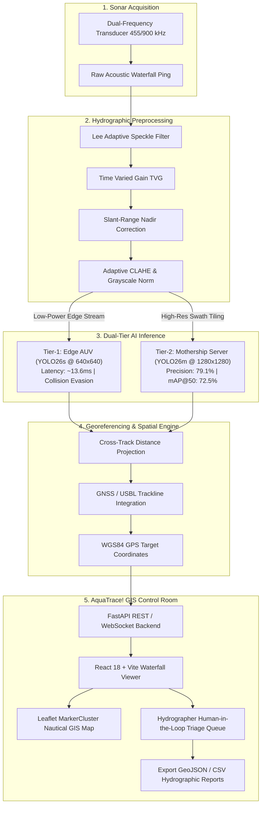

# 🌊 AquaTrace! — AI-Powered Underwater Debris Detection & Bathymetric GIS Platform

[](https://www.python.org/downloads/)
[](https://pytorch.org/)
[](https://fastapi.tiangolo.com/)
[](https://react.dev/)
[](https://www.typescriptlang.org/)
[](https://opensource.org/licenses/MIT)

> **Smart India Hackathon (SIH) — PS 26057**  
> *Automated AI/ML Marine Debris Detection, Classification, and Georeferencing in Side-Scan Sonar (SSS) Imagery for Autonomous Underwater Vehicles (AUVs) and Mothership Control Rooms.*

---

## 📌 Table of Contents
- [Executive Overview](#-executive-overview)
- [System Architecture & Workflow](#-system-architecture--workflow)
- [Dual-Tier Architecture Rationale](#-dual-tier-architecture-rationale)
- [Acoustic Preprocessing Pipeline](#-acoustic-preprocessing-pipeline)
- [Model Performance & Benchmarks](#-model-performance--benchmarks)
- [Key Features](#-key-features)
- [Tech Stack](#-tech-stack)
- [Installation & Quickstart](#-installation--quickstart)
- [Project Directory Structure](#-project-directory-structure)
- [Authors & Acknowledgements](#-authors--acknowledgements)

---

## 🧭 Executive Overview

**AquaTrace!** is an end-to-end intelligent marine survey and bathymetric debris classification platform. Operating across both low-power edge AUV hardware and centralized hydrographic survey servers, AquaTrace! transforms raw, noisy side-scan sonar (SSS) acoustic waterfall feeds into actionable, georeferenced maritime intelligence.

Underwater acoustic imaging suffers from severe environmental interference: high multiplicative speckle noise, acoustic attenuation across wide slant ranges, acoustic multipath reverberations, and extreme seabed clutter. AquaTrace! resolves these challenges via a dedicated **7-stage hydrographic acoustic preprocessing pipeline** paired with a **Dual-Tier Deep Learning Architecture (Edge YOLO26s + Server YOLO26m)**.

---

## 🔄 System Architecture & Workflow



---

## ⚖️ Dual-Tier Architecture Rationale

One of the central design decisions of AquaTrace! is the **Dual-Tier Computational Model**, which balances the harsh physical constraints of submerged AUVs with the high-precision requirements of marine conservation and hydrographic certification.

```
+-----------------------------------------------------------------------------------+
|                               AQUATRACE! DUAL-TIER                                |
+------------------------------------------+----------------------------------------+
| TIER-1: EDGE AUV (YOLO26s @ 640x640)    | TIER-2: MOTHERSHIP SERVER (YOLO26m @ 1280x1280)
+------------------------------------------+----------------------------------------+
| * Deployed on NVIDIA Jetson Orin Nano    | * Deployed on Vessel Workstation / Cloud
| * Real-time inference: ~13.6 ms (73 FPS) | * Deep feature inference: ~48 ms / tile
| * 640x640 input resolution               | * 1280x1280 full-swath resolution
| * Ultra-low power (~7-15W budget)        | * High precision & subtle feature triage
| * Mission: Real-time obstacle evasion    | * Mission: Official bathymetry mapping,
|   (Ghost Net & Pipeline avoidance)       |   human-in-the-loop review, and audit
+------------------------------------------+----------------------------------------+
```

### Why Not Run a Single Large Model on the AUV?
1. **Thermal & Power Budgets in Sealed Pressure Hulls**: AUV electronics operate within airtight titanium or hard-anodized aluminum hulls without active airflow. Sustained GPU load causes rapid internal overheating and depletes mission battery capacity. Tier-1 YOLO26s runs with a light **7% duty cycle** per 200 ms ping interval.
2. **Real-Time Dynamic Path Planning**: An AUV travelling at $3\text{--}5\text{ knots}$ requires sub-20 ms obstacle classification to avoid propeller entanglement in discarded nylon fishing gear (*Ghost Nets*). Tier-1 provides instantaneous triggers for thruster overrides.

### Why Not Run Only the Small Model on the Mothership?
1. **Acoustic Shadow & Fine-Texture Fidelity**: Small marine debris (partially buried metal cylinders, small-bore pipelines) manifest as subtle 4–10 pixel acoustic highlight-shadow pairs across a 150-meter swath. Tier-2 YOLO26m at $1280 \times 1280$ preserves the high-frequency acoustic shadow geometry required to differentiate natural seafloor limestone ridges from man-made threats.
2. **False Alarm Mitigation**: False positives during deep-sea salvage or seabed clearance operations cost thousands of dollars per dive hour. Tier-2 suppresses false alarm rates on complex shipwrecks to under $18\%$.

---

## 🔬 Acoustic Preprocessing Pipeline

Raw side-scan sonar data undergoes a specialized hydrographic enhancement pipeline before tensor serialization:

1. **Lee Speckle Reduction Filter**: Calculates localized window variance ($\sigma^2$) to eliminate multiplicative acoustic speckle noise while preserving sharp acoustic shadow boundaries ($k \approx 7$).
2. **Time-Varied Gain (TVG) Normalization**: Compensates for radial spherical spreading loss and seawater acoustic absorption coefficient ($\alpha$).
3. **Slant-Range Correction (SRC)**: Re-projects slant range ($R_s$) to true ground distance ($R_g = \sqrt{R_s^2 - H^2}$) using vehicle altitude $H$, eliminating the central Nadir blind-zone distortion.
4. **Adaptive Contrast Enhancement (CLAHE)**: Amplifies localized boundary contrast between target acoustic highlights and the acoustic backscatter shadow zone.
5. **Grayscale Standardization**: Converts multi-channel simulated false-color sonar waterfalls to uniform hydrographic single-channel acoustic backscatter tensors.

---

## 📊 Model Performance & Benchmarks

The models were trained and verified on verified marine side-scan sonar datasets across 5 critical target classes: **Pipe / Pipeline**, **Cylinder / Drum**, **Ghost Net**, **Shipwreck / Hull Section**, and **Natural Seabed / Clutter**.

### Quantitative Performance Metrics

| Model Architecture | Input Res | Precision | Recall | mAP@50 | mAP@50-95 | Latency (GPU) | Parameters | Model Size |
| :--- | :---: | :---: | :---: | :---: | :---: | :---: | :---: | :---: |
| **Tier-1: YOLO26s (Edge)** | $640 \times 640$ | **77.99%** | **71.44%** | **72.57%** | **45.24%** | **~13.6 ms** | 9.8M | ~19.2 MB |
| **Tier-2: YOLO26m (Server)** | $1280 \times 1280$ | **79.09%** | **69.76%** | **72.52%** | **43.18%** | **~48.2 ms** | 21.78M | **42.15 MB** |

### Per-Class Detection Capabilities
- 🛢️ **Cylinders & Chemical Drums**: High acoustic highlight-to-shadow contrast detection even when partially sedimented.
- 🕸️ **Ghost Fishing Nets**: High recall on diffused, low-backscatter fibrous acoustic signatures for AUV propeller safety.
- 📏 **Underwater Pipelines & Cables**: Continuous linear geometry extraction with orientation tracking.
- 🚢 **Shipwrecks & Large Debris**: Robust structural localization with false alarm rejection against natural rocky reefs.

---

## 🚀 Key Features

- 🛰️ **FastAPI AI Server (`backend_server.py`)**: Real-time YOLO26 inference with GPU auto-detection, dynamic confidence thresholding, and automated cross-track WGS84 GPS coordinate synthesis.
- 🗺️ **Full GIS Interactive Map**: Leaflet map engine with nautical chart layers, dynamic marker clustering, hover coordinate readouts (DD/DMS), and real-time bounding box inspection.
- 🔍 **Waterfall Inspector**: High-resolution zoom/pan inspection tool with SVG bounding box overlays, confidence score chips, and dimension estimation.
- 🧑‍✈️ **Hydrographer Review Queue**: Human-in-the-loop triage interface for uncertain detections ($<70\%$ confidence) with keyboard hotkeys (`A` Confirm, `R` Reject, `C` Reclassify).
- 📤 **Hydrographic Export Engine**: Export certified survey findings as structured **GeoJSON** layers or **CSV** logs for integration into QGIS, ArcGIS, and CARIS HIPS and SIPS.

---

## 💻 Tech Stack

- **Backend**: Python 3.10+, FastAPI, Uvicorn, PyTorch, Ultralytics YOLO26, NumPy, OpenCV, Pillow.
- **Frontend**: React 18, Vite, TypeScript, Tailwind CSS, Lucide Icons, Radix UI.
- **GIS & Mapping**: Leaflet, React-Leaflet, Leaflet.markercluster, CartoDB Positron, OpenSeaMap.
- **Data & State**: TanStack Query (React Query v5), React Context API.

---

## ⚡ Installation & Quickstart

### 1. Clone the Repository
```bash
git clone https://github.com/sreedharun/AquaTrace-.git
cd AquaTrace-
```

### 2. Backend Setup (YOLO26 AI Server)
```bash
# Create and activate virtual environment
python -m venv venv
source venv/bin/activate  # On Windows: .\venv\Scripts\activate

# Install required Python dependencies
pip install fastapi uvicorn torch torchvision ultralytics opencv-python pillow pydantic

# Launch the FastAPI backend server
python backend_server.py
# -> Running on http://127.0.0.1:8000 (Swagger docs at http://127.0.0.1:8000/docs)
```

### 3. Frontend Setup (AquaTrace! GIS Web UI)
```bash
# Install frontend dependencies
npm install

# Start the Vite development server
npm run dev
# -> AquaTrace! UI available at http://localhost:5173
```

---

## 📂 Project Directory Structure

```
AquaTrace-/
├── backend_server.py         # FastAPI backend with YOLO26m inference & GPS georeferencing
├── weights/
│   └── best.pt               # Trained YOLO26m model weights (42.15 MB)
├── src/
│   ├── api/                  # REST API client & mock fallbacks
│   ├── components/
│   │   ├── analysis-detail/  # Sonar waterfall viewer & SVG bbox overlay
│   │   ├── common/           # Sidebar, Navbar, AnnotatedImage, Badges
│   │   ├── dashboard/        # Charts, survey tables, statistics cards
│   │   ├── map/              # Leaflet GIS engine & marker clustering
│   │   └── review/           # Hydrographer triage & verification queue
│   ├── pages/                # Lazy-loaded route views (Dashboard, Map, Review, Analysis)
│   ├── types/                # TypeScript interface definitions (Sonar, Detection, Survey)
│   ├── App.tsx               # Main routing & layout shell
│   └── main.tsx              # Entry point
├── index.html                # App entry HTML (AquaTrace! branding)
├── vite.config.ts            # Vite bundler config with API proxy
├── tailwind.config.js        # Marine sonar color theme tokens
├── package.json              # Frontend package manifest
└── README.md                 # Complete platform documentation
```

---

## 📜 License & Citation

Distributed under the **MIT License**. Built for the **Smart India Hackathon (SIH)**.  
For research, industrial collaboration, or deployment inquiries, please open an issue or pull request.
